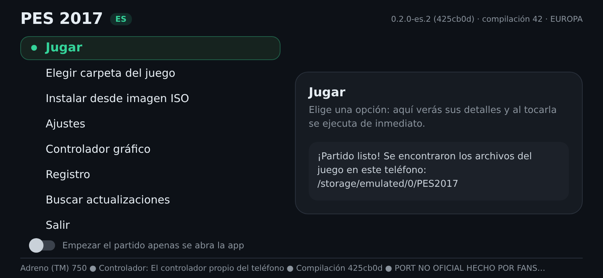

# PES 2017 (port recompilado) — Versión en español latinoamericano

Modificación del port recompilado de PES 2017 para Android (proyecto oficial
[dzakyraf/pes2017-recomp](https://github.com/dzakyraf/pes2017-recomp), versión 0.2.0, la más reciente),
con la interfaz y el juego en **español**, optimizada para el **Galaxy S24 Ultra**.

> Esta app **no incluye datos del juego**: necesitas tu propia copia de
> PES 2017 de **Xbox 360 (Europa)** (imagen `.iso` o carpeta con `default.xex` y los `.cpk`).


*Vista previa aproximada de la pantalla principal (tamaño del S24 Ultra en horizontal).*

## Descargar

- **Releases**: pestaña [Releases](../../releases) del repositorio → `PES-2017-ES-v0.2.0-es.2.apk`.
- **Directo**: [apk/PES-2017-ES-v0.2.0-es.2.apk](apk/PES-2017-ES-v0.2.0-es.2.apk) → botón "Download raw".

ID `com.pes2017.recomp.es`, nombre **"PES 2017 ES"**: se instala **junto** a la app original
sin borrarla. Si ya tenías una versión ES anterior, se instala encima y conserva tus partidas.

## Cómo dejarlo en español y a 60 FPS (S24 Ultra)

1. Instala el APK y ábrelo. **El primer arranque del juego tarda unos minutos**: compila todos
   los shaders una sola vez para que el partido no tenga tirones.
2. *Ajustes → Idioma y controles → Idioma del juego*: **Español latinoamericano** (viene marcado).
3. Al iniciar el juego aparecen sus pantallas de idioma: elige **Español**.
   Los textos y comentarios dependen de los paquetes de idioma (`dt20_*.cpk`) de tu ISO. Si tu
   disco no trae la variante latinoamericana, el juego usa el español que traiga.
4. Si ves cuadros negros, jugadores negros o tirones: *Controlador gráfico → Descargar un
   controlador* (Turnip para Adreno 750). Suele ser más rápido y dibuja bien cosas que el
   controlador de fábrica dibuja mal. Si empeora, *Quitar* lo deja como estaba.
5. Para ver los FPS: *Ajustes → Avanzado → Indicador de rendimiento → Completo*.
   Muestra FPS, ms por cuadro, CPU y temperatura.

## Qué cambia respecto al APK original

### 1. Español en la app y en el juego
* Los 306 textos de la app y 27 textos fijos en el código, traducidos al español latinoamericano
  (`traduccion/strings_es419.xml`, con comentarios en español).
* **Idioma dentro del juego** (`scripts/parchear_idioma_motor.py`): en el motor original
  (`runtime/kernel/misc.cpp`, `pes_imports.cpp`, `xam.cpp`) las funciones con las que el juego
  pregunta el idioma de la "consola" (`XGetLanguage`, `XamGetLanguage`, `ExGetXConfigSetting`)
  devolvían **siempre inglés**. Por eso el juego no ofrecía el español. Se reescribieron en
  ensamblador ARM64 (mismo tamaño y direcciones) para leer `PES17_LANGUAGE`/`PES17_COUNTRY`,
  que la app fija según el ajuste *Idioma del juego*:

  | Opción | Idioma | Región |
  |---|---|---|
  | Español latinoamericano (por defecto) | 5 (español) | 22 (México) |
  | Español de España | 5 (español) | 31 (España) |
  | English (original del port) | 1 (inglés) | 6 (la original) |

  `scripts/probar_idioma_motor.py` ejecuta las funciones parcheadas en un emulador ARM64
  (Unicorn) y comprueba los valores de cada opción.

### 2. Interfaz moderna y minimalista (`scripts/redisenar_interfaz.py`, `parches/res/`)
* Tema oscuro (#0D1117) con tarjetas redondeadas y **un solo color de acento** (verde #34D399).
* Sin degradados, barras de colores, imágenes de jugadores de fondo, cursivas ni MAYÚSCULAS forzadas.
* Pantalla principal nueva: encabezado limpio, menú con indicador de la opción elegida y tarjeta de detalles.
* Diálogos y barra de estado oscuros. Todos los IDs que usa el código se conservan
  (comprobado: los 1480 recursos originales mantienen su número).

### 3. Galaxy S24 Ultra a 60 FPS (`parches/Estabilidad.smali`, `perfilS24`)
Se aplica **una vez** en modelos `SM-S928*`, también encima del perfil de la versión anterior:
* La calibración oficial **"Alto"** para Adreno 7xx: escena al **75%**, MSAA activado, FSR desactivado,
  límite de 60 FPS. La versión ES anterior subía la escena al 100% y activaba FSR y panorámica,
  o sea más carga que la oficial.
* **Compilar todos los shaders al arrancar**: el partido ya no tiene tirones por shaders.
* **Pantalla fija a 60 Hz** y **bajar calidad al calentarse**: cuando el teléfono se calienta pierde
  nitidez en vez de fluidez.
* Panorámica **desactivada**: estira menús y marcador y dibuja más estadio. Se puede activar en
  *Ajustes → Pantalla*.
* Sin cambios de afinidad de núcleos: el motor ya reparte bien el 8 Gen 3
  (núcleo X4 para el hilo principal, los 5 A720 para el resto).

### 4. Estabilidad y pantalla
* Modo de poca memoria automático en teléfonos de 6 GB o menos.
* En Android 9+ el partido usa toda la pantalla, incluida la zona de la cámara.

### 5. Limpieza
* Se quitó el código que agregó el sitio **apkvision** (forzaba el idioma inglés, mostraba un aviso
  "APKVISION.ORG" y consultaba "actualizaciones" abriendo el navegador). Las bibliotecas nativas
  restantes (`libhook_impl`, `libmain_hook`, etc.) son las de *adrenotools* del port, usadas
  para cargar controladores Turnip.

### 6. ID distinto
`com.pes2017.recomp.es`, con *authorities* y permiso interno propios para no chocar con la original.

## Cómo regenerar el APK

```bash
PES_LLAVE_PASS='contraseña' scripts/construir_apk.sh \
    original.apk apktool.jar uber-apk-signer.jar pes2017-es.jks salida.apk
```

Usa siempre la **misma llave** (`pes2017-es.jks`), porque si no Android no deja actualizar
encima. La llave **no** se sube al repositorio (ver `.gitignore`).

## Notas

* Las partidas y ajustes de la versión ES son independientes de los de la original. Para pasar tus
  partidas: en la original, *Settings → Game files → Back up saves*. En la ES,
  *Ajustes → Archivos → Restaurar partidas*.
* "Buscar actualizaciones" apunta a la versión oficial en inglés. Si la instalas, se agrega como la
  app original, no encima de esta.
* Problema conocido del port oficial: las pantallas de idioma del juego aparecen en cada inicio.
